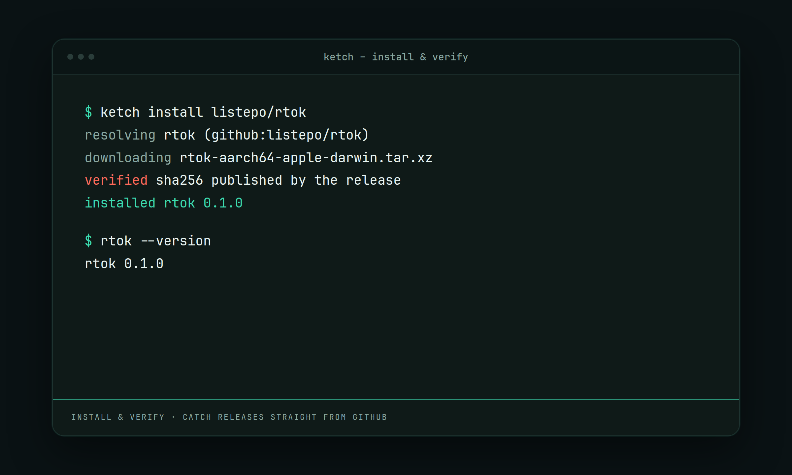
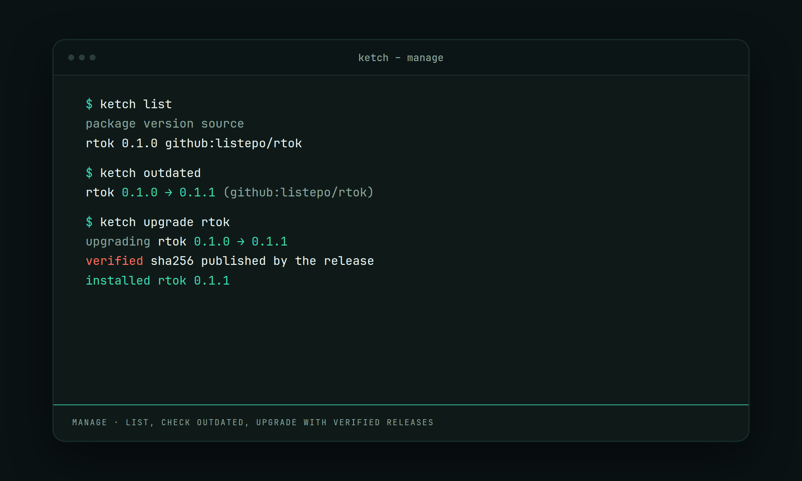

> [!NOTE]
> This project is under active development. We need "testing volunteers": try it and report what breaks.

<div align="center">


# ketch

**Install any CLI tool or app straight from its GitHub releases — no formula, checked against the published checksum, versioned, and cleanly removable.**

[](#license)

[](https://github.com/pyrlyn/ketch/releases/latest)
[](https://github.com/pyrlyn/ketch/actions/workflows/ci.yml)
<br>
[](https://sonarcloud.io/summary/new_code?id=listepo_ketch) [](https://sonarcloud.io/component_measures?id=listepo_ketch&metric=coverage) [](https://sonarcloud.io/component_measures?id=listepo_ketch&metric=tests)

**Catch releases straight from GitHub.**

Install command-line tools and apps from GitHub releases on macOS, Linux, and Windows.
No taps, no formulae, no build step — ketch downloads what a project already
ships, verifies it, and puts it on your `PATH`.

[Documentation](docs/) ·
[Registry](https://github.com/pyrlyn/ketch-registry) ·
[Roadmap](ROADMAP.md)

</div>

---

## Quick start

```bash
curl -fsSL https://raw.githubusercontent.com/pyrlyn/ketch/main/install.sh | bash
ketch install BurntSushi/ripgrep     # any repo that publishes releases
ketch why rg                         # how it was resolved, and which asset won
```

On Windows, install ketch with
`irm https://raw.githubusercontent.com/pyrlyn/ketch/main/install.ps1 | iex`;
the other commands are the same. `ketch list local` shows what you have.

A package can be named several ways:

```bash
ketch install BurntSushi/ripgrep     # any repo that publishes releases
ketch install rg                     # or a name ketch already knows
ketch install sharkdp/fd@v10.2.0     # or an exact version
ketch install --path ./mytool        # a local binary, archive, symlink, or .app
ketch install local:/abs/or/rel      # same thing, as a package ref
```

## Demo

**Install & verify.** `ketch install pyrlyn/rtok` downloads the release, checks
the published SHA-256, and leaves the binary on your `PATH`.



**Manage.** `ketch list`, `ketch outdated`, and `ketch upgrade` keep installed
tools current — each upgrade is verified the same way.



## Why ketch

Most command-line tools are already published as a release asset built for your
machine. A package manager does not need to compile them, and a maintainer does
not need to write a formula for them — the artefact is right there. ketch picks
the right one, checks the checksum the project published, unpacks it into a
versioned store, and links it onto your `PATH`.

- **Any repo that ships releases.** No formula, no tap, no waiting for a
  maintainer. Point it at `owner/repo`.
- **Verified, not just downloaded.** Published SHA-256 sums are checked against
  what landed on disk. `require_checksums` refuses anything that publishes none,
  and ketch's own updates never accept trust-on-first-use.
- **Apps as well as binaries.** An `.app` bundle goes to `/Applications`,
  quarantine cleared when the signature checks out, removed cleanly on
  uninstall.
- **One tree.** Everything under `~/.ketch`. Uninstalling leaves nothing behind.
- **Sources beyond GitHub.** A plugin is one executable that answers in JSON —
  no recompile, no ketch release.

## Highlights

| | |
| --- | --- |
| **Explains its choices** | `ketch why <pkg>` traces a resolution without installing; `ketch info <pkg> --assets` lists every release asset with its score and the reason. |
| **Checksums and signatures** | SHA-256 from the release's checksum files or GitHub's own asset digest. A manifest's `trust` table requires a publisher signature — sigstore, minisign or gpg — and a release without it is refused. See [docs/MANIFESTS.md](docs/MANIFESTS.md). |
| **Rollback without a re-download** | An upgrade keeps the previous version on disk; `ketch rollback <pkg>` relinks it. |
| **Reproducible machines** | `ketch lock` writes `ketch.lock`; `ketch sync` installs exactly what it names. |
| **Fast batches** | Downloads run four at a time by default (`--jobs N`). |
| **History that outlives packages** | `ketch history` and `ketch stats` read an append-only `stats.db`. |
| **Changelogs on demand** | `ketch changelog <pkg>` shows the shipped `CHANGELOG.md` entry, or the release notes. |
| **Manages itself** | ketch is one of its own packages: `ketch self upgrade`, `ketch self uninstall`. |

## Install

```bash
curl -fsSL https://raw.githubusercontent.com/pyrlyn/ketch/main/install.sh | bash
```

On Windows:

```powershell
irm https://raw.githubusercontent.com/pyrlyn/ketch/main/install.ps1 | iex
```

Both installers take `--pre` to install the newest release, prereleases
included (`curl … | bash -s -- --pre`; on Windows,
`& ([scriptblock]::Create((irm …/install.ps1))) --pre`).

or with Homebrew:

```bash
brew install --cask pyrlyn/tap/ketch
```

Either way ketch ends up in `~/.ketch`, installed as one of its own packages:
`ketch list` shows it, and `ketch self upgrade` upgrades it like anything else.
The curl and PowerShell installers run `ketch self install`, then `ketch path
install`, and place a bootstrap copy at `--install-dir` when you give one.
Homebrew keeps nothing but the bootstrap binary, and `brew upgrade` hands over
to `ketch self upgrade`.

With [mise](https://mise.jdx.dev), no installer runs; the release tarball is
the whole install:

```bash
mise use -g github:pyrlyn/ketch
ketch path install
```

mise then owns the binary: `mise upgrade` upgrades it, and `ketch self upgrade`
refuses to rewrite a file in mise's tree. Run `ketch self install` as well if
you would rather ketch manage itself, as with the installers above.

Then make sure `~/.ketch/bin` is on your `PATH`. `ketch doctor` will tell you if
it is not, along with anything else that needs attention.

To remove it again:

```bash
ketch self uninstall
```

That takes everything with it — every package ketch installed, the whole
`~/.ketch` tree, the `PATH` block in your shell startup files, the user PATH on
Windows, and the Homebrew
cask if that is how ketch arrived. It lists what it is about to delete and asks
first, because none of it can be recovered afterwards. `--keep-packages` removes
only ketch and leaves the tools it installed alone.

`brew uninstall --cask ketch` removes only the bootstrap binary Homebrew kept;
everything under `~/.ketch` and every package ketch installed stays until you
run `ketch self uninstall` (or delete the tree yourself). The same holds for
`mise unuse -g github:pyrlyn/ketch`. Run from a mise install, `ketch self
uninstall` asks, separately, whether to run that command for you as well.
A copy mise installed before the repository moved from `listepo` to `pyrlyn`
is still recognized, and the command names it `github:listepo/ketch`, the way
mise knows it.

## Usage

```bash
ketch install sharkdp/bat            # install from any owner/repo
ketch why bat                        # explain the resolution, install nothing
ketch info bat --assets              # every release asset, its score and why
ketch upgrade                        # bring everything unpinned up to date
ketch rollback bat                   # back to the previous version, no download
ketch lock                           # record this machine in ./ketch.lock
ketch sync                           # make another machine match it
ketch self upgrade                   # upgrade ketch itself
ketch uninstall bat                  # remove it, links and all
```

[docs/COMMANDS.md](docs/COMMANDS.md) has every command with a working example;
[docs/GUIDE.md](docs/GUIDE.md) covers the store and rollback, local installs,
history, changelogs, batches, the log, lockfiles, PATH setup and how a package
is resolved.

## Documentation

| | |
| --- | --- |
| [docs/COMMANDS.md](docs/COMMANDS.md) | Every command: what it does, and one working example |
| [docs/GUIDE.md](docs/GUIDE.md) | The store, rollback, history, lockfiles, PATH and resolution |
| [docs/COOKBOOK.md](docs/COOKBOOK.md) | Runnable recipes: a sandbox root, upgrade and rollback, pins, lockfile sync |
| [docs/CONFIGURATION.md](docs/CONFIGURATION.md) | `~/.ketch/config.toml`: every key and its environment variable |
| [docs/MANIFESTS.md](docs/MANIFESTS.md) | The package config: every field, and when you need one |
| [docs/REGISTRY.md](docs/REGISTRY.md) | The registry layout, and how to add a package to it |
| [docs/PLUGINS.md](docs/PLUGINS.md) | The source-plugin protocol, for sources other than GitHub |
| [docs/LOCKFILE.md](docs/LOCKFILE.md) | `ketch.lock`: pinning a machine's tools to exact releases |
| [docs/TROUBLESHOOTING.md](docs/TROUBLESHOOTING.md) | Common problems and what `ketch doctor` reports |
| [docs/COMPARISON.md](docs/COMPARISON.md) | Where ketch sits next to Homebrew, apt and mise |
| [docs/DEVELOPMENT.md](docs/DEVELOPMENT.md) | Building from source, CI and releasing |
| [ROADMAP.md](ROADMAP.md) | What is missing, and what is deliberately out of scope |
| [CONTRIBUTING.md](CONTRIBUTING.md) | Short contributor checklist |

## Contributing

Contributions are welcome. Found a bug or an asset ketch picks wrong?
[Open an issue](https://github.com/pyrlyn/ketch/issues) with the command you ran
and what `ketch why <pkg>` says. Read [CONTRIBUTING.md](CONTRIBUTING.md) and
[AGENTS.md](AGENTS.md) before a pull request; build and release steps are in
[docs/DEVELOPMENT.md](docs/DEVELOPMENT.md). To add a package to the registry,
see [docs/REGISTRY.md](docs/REGISTRY.md).

## License

You can use this project under **any** of the following licenses, at your choice:

1. [GNU GPLv3](LICENSE): free for open source applications on any platform, including embedded systems.
2. [Royalty-free License](LICENSE-ROYALTY-FREE.md): free for proprietary desktop, mobile, and web applications, as long as you disclose that your application uses this project. Embedded systems are not covered.
3. [Commercial license](PRICING.md): for proprietary applications, including embedded systems, without the attribution requirement.

<!-- license-sync:start -->
Commercial use not covered by the GPLv3 or the Royalty-free License requires a separate paid
license — see [PRICING.md](PRICING.md).
<!-- license-sync:end -->
